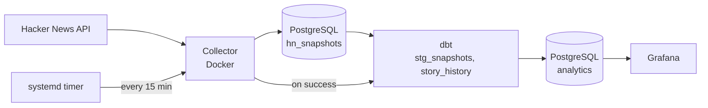

# Hacker News Pipeline

This is a project for data engineering, which I'm learning on the go.

A Python script collects a snapshot of the Hacker News front page (the top 100 stories) from the official Hacker News API every [15] minutes and stores it in PostgreSQL. dbt then cleans and models the data, and Grafana shows it in a dashboard.

## How it works




## How to run it

I built this on Linux (CachyOS, which is based on Arch). The steps should work on other Linux systems, but the systemd part will not work on Windows or macOS.

### 1. Start the database and Grafana

1. Clone the repo.
2. Copy `.env.example` to `.env` and set a password in it. The same password is used for the PostgreSQL user.
3. Run `docker compose up -d`. The volumes are created automatically the first time.
4. Test the collector once: `docker compose run --rm collector`. The first run builds the image.

### 2. Set up dbt (in a virtual environment)

dbt is not part of the collector's Docker image. It runs on the host, inside a Python virtual environment, so it has to be installed separately:

```
python -m venv de
source de/bin/activate        # fish shell: source de/bin/activate.fish
pip install dbt-postgres
```

I named my virtual environment `de`. It is in `.gitignore`, so it is not part of the repo.

dbt reads its database settings from `~/.dbt/profiles.yml` (in the home folder, outside the repo, so the password is never committed). Create it with these values:

- profile name: `hn_dbt` (it has to match the name in `hn_dbt/dbt_project.yml`)
- host: `localhost`, port: `6283` (the port published by the `pg` container)
- user: `postgres`, password: the one from your `.env`
- database: `postgres`, schema: `analytics`

Then check the connection and build the models:

```
cd hn_dbt
dbt debug
dbt build
```

### 3. Create the read-only user for Grafana (optional)

Any changes made in the Grafana's dashboard can changed the actual values in the table. If you want to avoid any accidental damage to data, you can change Grafana's dashboard settings to read-only.

### 4. Set up the systemd timer

The files in `systemd/` contain my own paths, so they have to be edited before use. There are three kinds of paths to change:

| File | Setting | Point it to |
|---|---|---|
| `hn.service` | `WorkingDirectory` | The folder where you cloned the repo (it must contain `docker-compose.yml`) |
| `hn.service` | `ExecStart` | The full path of the `docker` command, which `which docker` prints (usually `/usr/bin/docker`), followed by `compose run --rm -T collector` | (the last command is to be run only once)
| `hn-dbt.service` | `WorkingDirectory` | The `hn_dbt` folder inside the cloned repo |
| `hn-dbt.service` | `ExecStart` | The `dbt` program **inside your virtual environment**: `<repo folder>/de/bin/dbt build` |

systemd does not know about the virtual environment, which is why it needs the full path to `dbt` and not just the word `dbt`. The timer file has no paths.

Copy the three files into `~/.config/systemd/user/` and start the timer:

```
mkdir -p ~/.config/systemd/user
cp systemd/hn* ~/.config/systemd/user/
systemctl --user daemon-reload
systemctl --user enable --now hn-collect.timer
```

To check that it works, run `systemctl --user start hn.service`, then read the logs with `journalctl --user -u hn.service` and `journalctl --user -u hn-dbt.service`. The dbt service starts only if the collector succeeds.

The timer only runs while my computer is on and I'm logged in, so there are gaps in the data.

## Tools used

- **Python**: collects the data (`requests` and `psycopg2`)
- **PostgreSQL**: stores every snapshot
- **dbt**: cleans the data and builds the tables, and runs tests on them
- **Docker and Docker Compose**: run the collector, PostgreSQL and Grafana
- **systemd**: schedules the collector and the dbt build
- **Grafana**: the dashboard
- **Ruff and Forgejo Actions**: code checks on every push

## Versions

### Version 1: systemd

I created a service file and a timer file for running the Python script every [10/15] minutes with systemd. The script retries failed requests, and it saves nothing if fewer than 50 stories were collected.

### Version 2: dbt and Docker

1) dbt is connected to the PostgreSQL database. There is one view (`stg_snapshots`) and a single mart (`story_history`, with one row per story) as of now. To avoid the mart going stale, I added a second service file that runs `dbt build`, which runs the models and then the tests (both built-in and user defined). This service only triggers if the collector runs successfully.

2) The collector now runs in Docker. The `Dockerfile` uses Python 3.12 and installs the packages from `requirements.txt`. The image is built once. Every time `docker compose run --rm collector` is run, a new container starts from that image, collects the data and is deleted afterwards.

### Version 3: Grafana

I added Grafana to the docker compose file. It connects to PostgreSQL with a read-only user (`grafana_ro`), so it cannot change any data. The dashboard is exported as JSON in `grafana/dashboards/`.

## Data

- `hn_snapshots` (raw): one row per story per snapshot. It is never edited, only added to.
- `stg_snapshots` (view): the same rows, cleaned, with `domain` and `age_hours` added.
- `story_history` (table): one row per story, with first and last seen, best rank, and first, last and peak score.

## Data quality

The dbt tests check that `story_id` is unique and not null in `story_history`, that a story appears only once per snapshot, and that scores, comments and ranks have valid values.


## Limitations

- Snapshots are only taken while my PC is on and running Linux, so there are gaps in the data.
- Only the top 100 stories are tracked, so I can't see a story before it enters or after it leaves the top 100.
- The mart is only as fresh as the last `dbt build`.
- Can only be run in Linux systems. Haven't tested it on WSL.

## What's next

- Move the scheduling to Airflow
- Use the data for machine learning experiments

This is my first time working on these, so I would appreciate any feedback.
